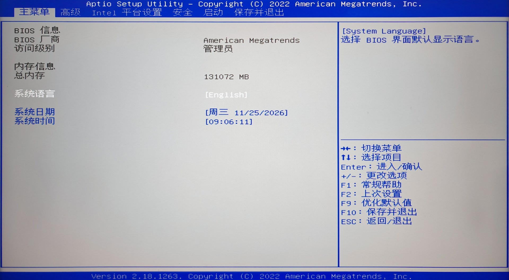
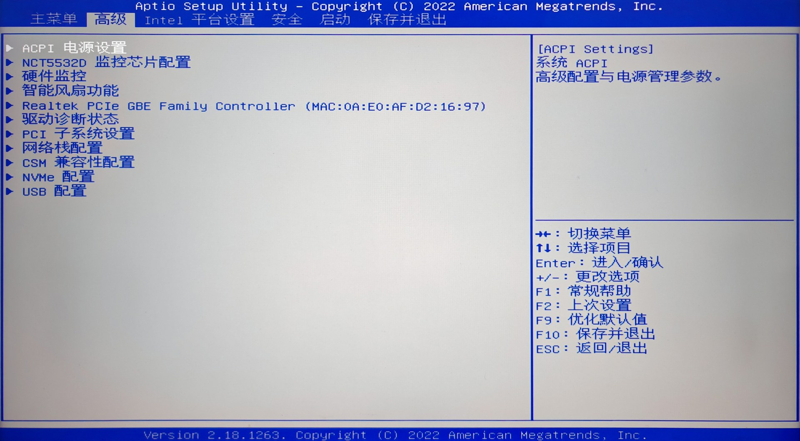
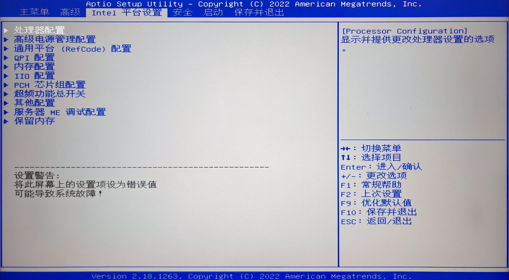
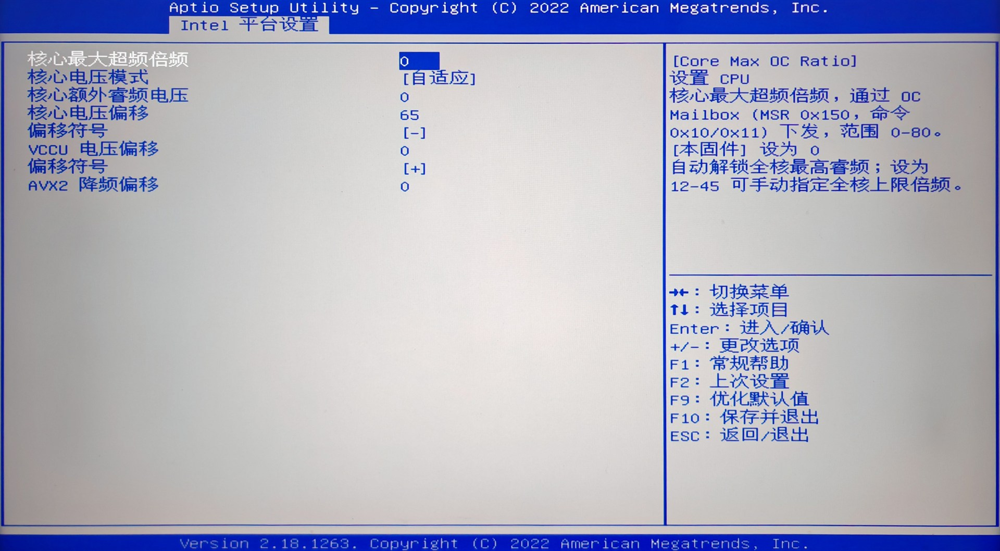
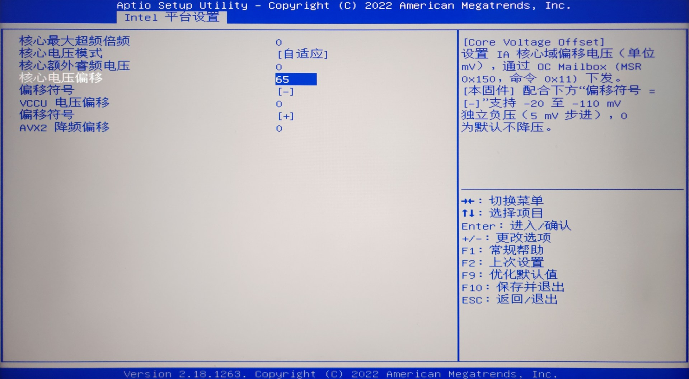
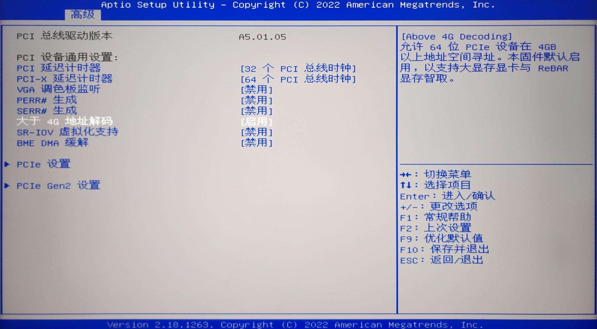
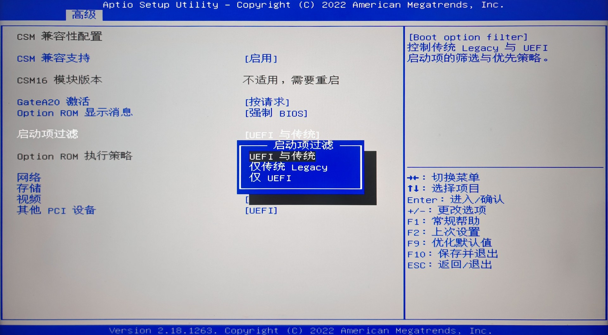

# HUANANZHI X99-TF V3.0 JX — Dynamic All-Core Turbo + Bilingual UI + IA/CLR Undervolt + ReBAR

> 中文说明: [README.md](README.md)

Custom BIOS kit based on the official `TFV30JX.bin` (X99-TF V3.0 JX, 2022-09-16).  
Integrates a **menu-driven Haswell-EP (`0x306F2`) All-Core Turbo engine**, **Chinese/English bilingual setup UI**, **independent IA & CLR negative voltage offsets**, **Resizable BAR**, and a **Windows 11 24H2/25H2 Microsoft-signed microcode bypass toggle**.

> **Flashing a modified BIOS carries risk.** Always verify your board model (`X99-TF V3.0 JX`, 16 MB SPI flash) and keep a full 16 MB backup.  
> **Community Feedback**: Bilibili commenters reported that **HUANANZHI X99-8M** works normally with this BIOS (cross-flashing carries extra risk — always back up your stock SPI flash first and consider flashing the 8 MB BIOS region only).

---

## Real-Hardware Screenshots

*Main Menu: BIOS info, 131072 MB memory, and bilingual UI with `[System Language]` English reference pinned at top-right*

| | |
| :---: | :---: |
|  **Advanced Menu**: ACPI, NCT5532D Super I/O, PCI Subsystem, CSM, and NVMe menus |  **Intel Platform Setup (`IntelRCSetup`)**: Processor, Power Management, and OverClocking entry |
|  **Core Max OC Ratio**: `[Core Max OC Ratio]` with `[本固件]` auto full-turbo / manual cap notes |  **Core Voltage Offset**: Independent IA undervolt (`-65 mV` shown) with range and step notes |
|  **PCI Subsystem Settings**: `Above 4G Decoding` enabled by default for large VRAM and ReBAR |  **CSM Configuration**: Bilingual popup menu and `[Boot option filter]` help with zero missing glyphs |

---

## 1. Key Features & Architecture

- **Terminology-Refined Bilingual UI & Full Proofread Help**: Built directly from stock `TFV30JX.bin` English strings. Left-pane menus use concise, hardware-accurate Chinese (clearly distinguishing `CLR/Ring` from `Uncore`, renaming `IntelRCSetup` to `Intel 平台设置`, and keeping standard acronyms clean without wrapping). Right-pane `Item Help` pins `[Original English Name]` on line 1 for instant cross-reference, provides proofread Chinese descriptions across all menus, and adds `[本固件]` runtime notes on key turbo/undervolt/power/C-state items. Includes a complete `SimSun 16px` 1bpp `AMITSE` `SimpleFont` (`958` glyphs total, **0 missing glyphs**).
- **BIOS-region surgical patch**: Flash Descriptor, ME (`0x000000..0x800000`), and PEI/microcode volume FV3 (`0xDA0000..0x1000000`) remain byte-for-byte identical to stock `TFV30JX.bin` (which natively omits `0x306F2` microcode so POST runs with `MSR 0x8B == 0`).
- **Upgraded `A134C001` Menu-Driven Engine**:
  - **Master Switch**: Controlled by `OverClocking Feature` (`0x161E`, now `Enabled` by default). Setting it to `Disabled` bypasses all voltage and turbo writes.
  - **Independent IA & CLR Undervolt**: Reads `Core Voltage Offset` (`0x1644/0x1646`) and `CLR Voltage Offset` (`0x167F/0x1681`), writing `MSR 0x150` Plane 0 (`0x80000011`) and Plane 2 (`0x80000211`) independently (`20–110 mV`, `5 mV` steps, negative prefix only; `0 mV` by default).
  - **SDM-Compliant CPU Guard**: Executes `wrmsr(0x8B, 0) → cpuid(1) → rdmsr(0x8B)`. Turbo/power MSRs are written **only** when `CPUID == 0x306F2` and `MSR 0x8B == 0` (Broadwell-EP v4 CPUs automatically skip turbo unlock while retaining voltage offset support).
  - **Menu-Linked Core & Ring Ratios**: Automatically detects hardware fuse max ratios (`38x` core / `30x` ring on E5-2696 v3). When `Core Max OC Ratio` (`0x1640`) or `CLR Max OC Ratio` (`0x167B`) is `0` (default), full max turbo is applied across all cores (`MSR 0x1AD..0x1AF`) and ring (`MSR 0x620`, preserving dynamic `CLR Min Ratio` `0x17A7 = 12x`); setting an explicit ratio in BIOS caps it cleanly without reflashing.
  - **Smart Power Limit Unlock (`MSR 0x610`)**: Raises stock `145W` TDP limits to a VRM-safe `PL1 = 220W / PL2 = 250W` when unlocked, while respecting higher user-configured RAPL values or explicit `Turbo Pwr Limit Lock`, then sets `MSR 0x194` bit 20 (`OC_LOCK`).
- **Out-of-the-Box Defaults** (synced across FV0 NVAR, `9221315B`, `FE612B72` SPF, and `ABBCE13D` IFR):
  - `OverClocking Feature = Enabled` (with `0 mV` default voltage offsets)
  - `Overclocking Lock = Disable` (`0x13DC = 1`)
  - `CPU C State = Enable` (`0x0069 = 1`), `Package C State limit = C2 state` (`0x006C = 1`), `CPU C6 report = Disable` (`0x006E = 0`)
  - `CSM Support = Disabled` & `Above 4G Decoding = Enabled`
  - `ACPI Sleep State (S3) = Disabled` (matches stock to prevent S3 resume MSR loss)
- **Windows 11 24H2/25H2 Safe Microcode Bypass (`WIN11_MCUPDATE_TOGGLE.bat`)**:
  - Replaces `mcupdate_GenuineIntel.dll` **in-place** with the Microsoft-signed `mcupdate_AuthenticAMD.dll` stub (while backing up the original to both `System32` and `bak\` and restoring `TrustedInstaller` ACLs), preventing the Win11 24H2/25H2 boot-loop/BSOD caused by deleting or renaming `mcupdate_GenuineIntel.dll`.

---

## 2. Checksums

| File | Size (Bytes) | MD5 |
|---|---:|---|
| **`TFZH.ROM`** | 16,777,216 | `20a7af3eff4775b64788c8e448e4d8a0` |
| **`TFZH_8M.bin`** | 8,388,608 | `e1c424da50a72f3d9b70a75275e6b7d1` |
| `bak/TFV30JX.bin` | 16,777,216 | `e874c4531a47c5202b715ea670d763e2` |
| `bak/TFV30JX_ZH-BILINGUAL-TURBO-VOLT-CLR-REBAR-CSMOFF-4GON-C2-C6OFF.rom` | 16,777,216 | `20a7af3eff4775b64788c8e448e4d8a0` |

- `TFZH.ROM` SHA-256: `e5c1654c737ef23a1701dd3b28a9ebdde94ef5a665e15eae92c8614e5364aece`
- `TFZH_8M.bin` SHA-256: `ca0db222ec43ab0c34e174476182b19dd239d587993a5aefd14bedd0ea7901ca`

---

## 3. Quick Start

1. **Flash BIOS**: Right-click `FLASH_WINDOWS.bat` → **Run as administrator** (backs up current flash to `BACKUP.BIN`, then flashes `TFZH.ROM`; press `Y` when prompted).
2. **Clear CMOS / Load Defaults**: Clear CMOS (or run **Load Optimized Defaults** in BIOS) so the new defaults (`OverClocking Feature = Enabled`, `Package C State limit = C2 state`, `CPU C6 report = Disable`, `CSM = Disabled`, `Above 4G = Enabled`) apply automatically, and optionally set negative IA/CLR voltage offsets (e.g. IA `-50 ~ -65 mV`, CLR `-35 ~ -45 mV`, `CLR Max OC Ratio = 28/29`).
3. **Enable Windows Microcode Bypass & ReBAR**:
   - In Windows, run **`WIN11_MCUPDATE_TOGGLE.bat`** and press `Y` (never manually delete `mcupdate_GenuineIntel.dll` on Win11 24H2/25H2).
   - If CMOS was cleared, run **`ReBarState.exe`** as administrator and enter **`32`**.
   - **Reboot** to enjoy full all-core turbo, independent undervolt, and Resizable BAR.
